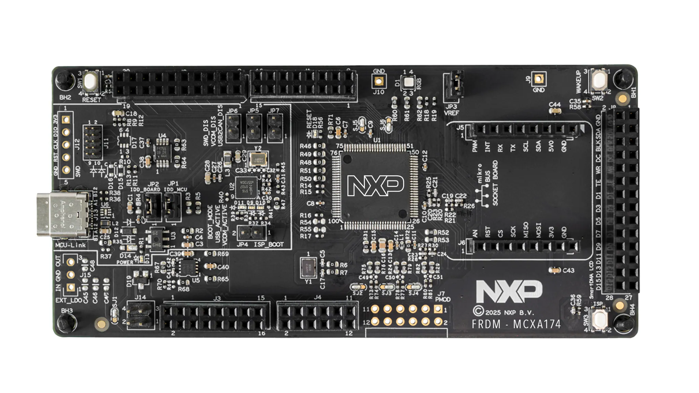
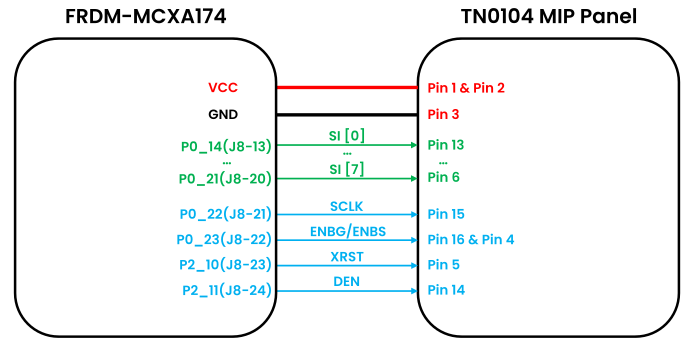
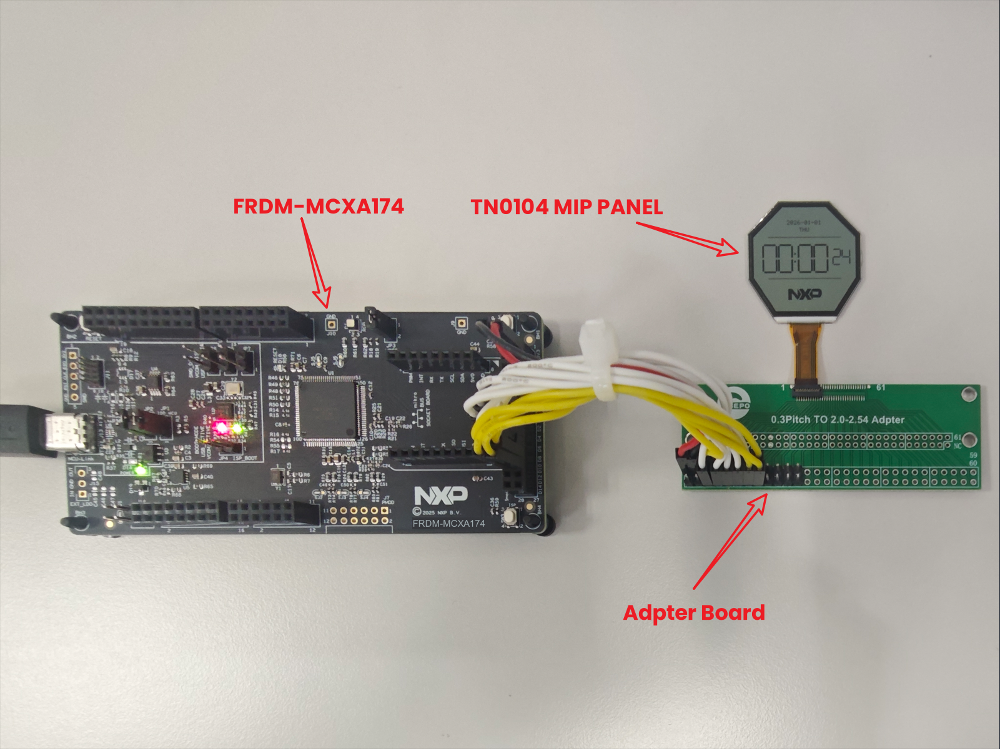
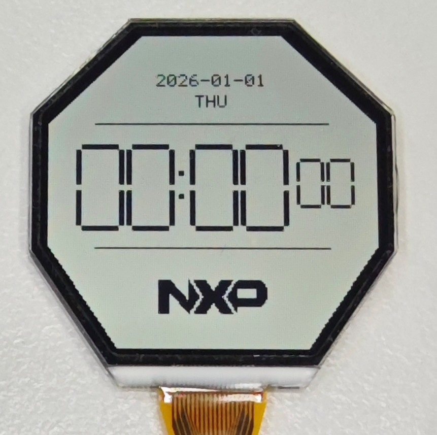

# NXP Application Code Hub

## AN15124 How to Drive a Memory-In-Pixel (MIP) Panel Using SmartDMA on MCX A Series MCUs

This software accompanies application note AN15124, *How to Drive a Memory-In-Pixel (MIP) Panel Using SmartDMA on MCX A Series MCUs*.

This example demonstrates how to drive a Kyocera TN0104ANVAANN-GN00 176 x 176 monochrome Memory-In-Pixel (MIP) LCD panel using the SmartDMA peripheral available on MCX A series microcontrollers.

The project runs on the FRDM-MCXA174 development board and implements a software-defined display pipeline. The Cortex-M33 core renders display content into a 1-bit frame buffer, while SmartDMA autonomously generates the timing-critical GPIO waveforms required by the MIP panel interface. This architecture enables deterministic display timing without requiring a dedicated LCD controller.

The software architecture is designed to be portable across MCX A series devices that integrate SmartDMA. The display update engine, frame buffer management layer, and SmartDMA firmware framework can be adapted to different MIP display resolutions and other GPIO-based display interfaces that require deterministic timing.

The demo showcases:

- SmartDMA-based MIP panel control
- Deterministic GPIO timing generation
- Portable SmartDMA display framework for other SmartDMA-enabled MCX A series MCUs
- Full-screen and partial-screen refresh
- 1-bit monochrome frame buffer rendering
- Low-power operation using Power Down mode
- SmartDMA offloading for reduced CPU utilization
- Reference implementation for wearable, always-on display, electronic shelf label, and low-power HMI applications

By combining the ultra-low-power characteristics of MIP technology with autonomous SmartDMA execution, this example demonstrates how MCX A series MCUs can be used to build efficient display systems for battery-powered embedded products.

Additional details are provided in application note AN15124.

#### Boards: FRDM-MCXA174
#### Categories: User Interface, Low Power
#### Peripherals: SmartDMA
#### Toolchains: VS Code

## Table of Contents
1. [Software](#step1)
2. [Hardware](#step2)
3. [Setup](#step3)
4. [Results](#step4)
5. [Support](#step5)
6. [Release Notes](#step6)

## 1. Software

The following software is required to build and run this example:

1. [VS Code](https://code.visualstudio.com/)
2. [MCUXpresso for VS Code extension](https://marketplace.visualstudio.com/items?itemName=NXPSemiconductors.mcuxpresso)
3. [MCUX SDK](https://mcuxpresso.nxp.com/select) (SDK_26_03_00_FRDM-MCXA174)

For detailed instructions on setting up the development environment, refer to [Getting Started with MCUXpresso for VS Code](https://www.nxp.com/design/design-center/training/TIP-GETTING-STARTED-WITH-MCUXPRESSO-FOR-VS-CODE).

## 2. Hardware

The following hardware is required to run this example:

1. [FRDM-MCXA174 development board](https://www.nxp.com/design/design-center/development-boards-and-designs/FRDM-MCXA174)
[

](./images/FRDM-MCXA174.png)
2. Kyocera TN0104ANVAANN-GN00 176 x 176 monochrome MIP LCD panel
3. TN0104 adapter board
4. USB Type-C cable
5. Host PC

The reference design connects the TN0104 MIP panel to the MCX A174 through GPIO signals generated by SmartDMA.

| Signal | Direction | Description |
|--------|-----------|-------------|
| SI[7:0] | Output | 8-bit address/data bus input to the MIP panel |
| SCLK | Output | Serial clock signal for address and display data transfer |
| DEN | Output | Address/data selection control signal |
| ENBG/ENBS | Output | Write enable strobe signal for display update operations |
| XRST | Output | Active-low hardware reset signal for the MIP panel |

The architecture can be adapted to other SmartDMA-capable MCX A series MCUs and other MIP display variants that use GPIO-based deterministic timing interfaces.

## 3. Setup

### 3.1 Prepare development environment

1. [Install VS Code.](https://www.nxp.com/design/design-center/training/TIP-GETTING-STARTED-WITH-MCUXPRESSO-FOR-VS-CODE)
2. [Install MCUXpresso for VS Code extension.](https://www.nxp.com/design/design-center/training/TIP-GETTING-STARTED-WITH-MCUXPRESSO-FOR-VS-CODE)
3. [Import the MCUX SDK repository.](https://www.nxp.com/design/design-center/training/TIP-GETTING-STARTED-WITH-MCUXPRESSO-FOR-VS-CODE)
   - Open MCUXpresso for VS Code extension.
   - In the Quick Start panel, click **Import Repository**.
   - Select **MCUXpresso SDK repository**.
   - Select the main revision or a specific revision if needed.
   - Select a save location.
   - Click **Import**.
   - The SDK repository import may take some time.

### 3.2 Import example from Application Code Hub

1. Open MCUXpresso for VS Code extension.
2. In the Quick Start panel, click **Application Code Hub**.
3. In the search text field, type the name of this example or `AN15124`.
4. Select the example project.
5. Enter a project name and choose the directory where the example will be saved.
6. Click **Import Project** and wait for the import process to complete.

### 3.3 Connect the hardware

1. Connect the TN0104 MIP panel to the TN0104 adapter board.
2. Connect the adapter board to the FRDM-MCXA174 board as below.
[

](./images/wire.png)
3. Connect the FRDM-MCXA174 board to the host PC using a USB Type-C cable.

### 3.4 Build and program

1. Build the project.
2. Program the generated image to the FRDM-MCXA174 board.
3. Reset the board or launch a debug session to start the demo.

### 3.5 Run the demo

After reset, the application initializes the MIP panel and starts periodic display updates.

The CPU renders the display content into a 1-bit frame buffer. SmartDMA then reads the frame buffer information through a parameter block and generates the GPIO timing sequence required to update the MIP panel.
[

](./images/demo_connection.png)

## 4. Results

After the application starts, the TN0104 MIP panel displays a watch-style user interface that includes:

- Date
- Day of week
- Real-time clock
- NXP logo

[

](./images/UI.jpg)

The display refresh operation is offloaded to SmartDMA. During display updates, the Cortex-M33 core prepares the frame buffer data and control parameters. All LCD timing signals are generated autonomously by SmartDMA without software-driven GPIO toggling.

The demo demonstrates:

- SmartDMA-controlled MIP panel refresh
- Autonomous GPIO timing generation
- Full-screen and partial-screen updates
- Real-time clock rendering
- Low-power display operation

### Power consumption

The demo uses a periodic 1-second update cycle. During each cycle, the MCU enters Active mode briefly to update the display and then transitions to Power Down mode for the remaining time.

Measured current values from AN15124 are summarized below:

| Mode | Duration | Duty cycle | Current | Weighted current |
|------|----------|------------|---------|------------------|
| Active | 4 ms | 0.4% | 1306 uA | 5.2 uA |
| Power Down | 996 ms | 99.6% | 17.7 uA | 17.6 uA |
| Average | 1000 ms | 100% | - | 22.8 uA |

These results demonstrate that SmartDMA-driven MIP display updates are suitable for ultra-low-power embedded applications, such as wearable devices, electronic shelf labels, and always-on user interfaces.

## 5. Support

For additional technical information, refer to:

- AN15124, *How to Drive a Memory-In-Pixel (MIP) Panel Using SmartDMA on MCX A Series MCUs*
- AN14650, *SmartDMA Cookbook*
- MCX A173 and MCX A174 Reference Manual
- TN0104ANVAANN-GN00 LCD Module Datasheet

#### Project Metadata

<!----- Boards ----->

<!----- Categories ----->

<!----- Peripherals ----->

<!----- Toolchains ----->

Questions regarding the content/correctness of this example can be entered as Issues within this GitHub repository.

> **Warning**: For more general technical questions regarding NXP Microcontrollers and the difference in expected functionality, enter your questions on the [NXP Community Forum](https://community.nxp.com/).

## 6. Release Notes

| Version | Description / Update | Date |
|:-------:|----------------------|-----:|
| 1.0 | Initial release on Application Code Hub | October 8th 2026 |

